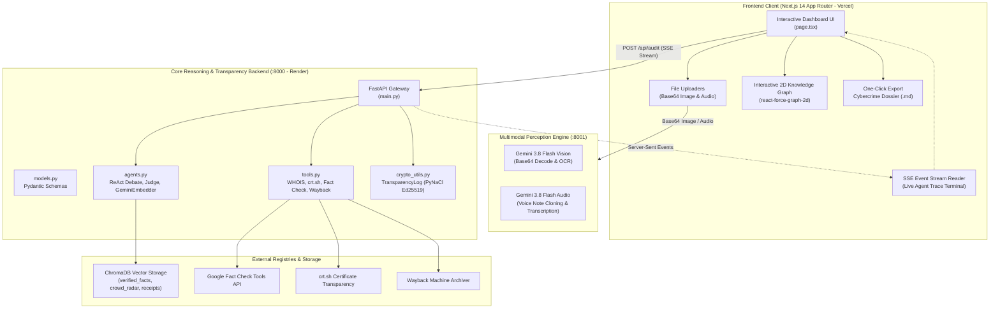
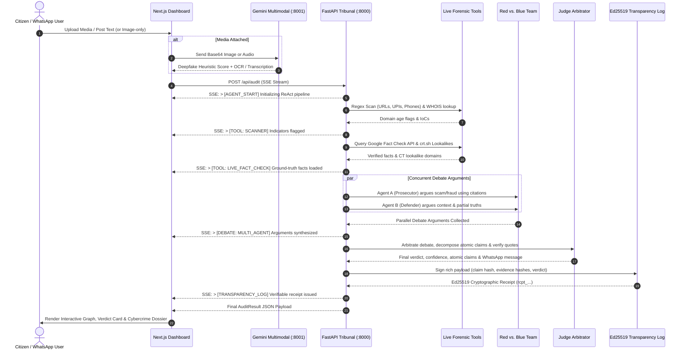

# 🛡️ DigitalScam / Cameto
### A Multimodal, Cryptographically Verifiable Agentic Cyber-Fraud Detection Pipeline

[](https://forgebuildathon.com)
[](https://nextjs.org)
[](https://fastapi.tiangolo.com)
[](https://pynacl.readthedocs.io)
[](https://www.trychroma.com)
[](https://ai.google.dev)
[](https://groq.com)

🚀 **Live Demo:** [DigitalScam / Cameto on Vercel](https://frontend-sand-three-14.vercel.app/)

> **DigitalScam (Cameto)** is an enterprise-grade, autonomous ReAct multi-agent intelligence system designed to combat viral misinformation, financial phishing scams, synthetic deepfake audio/imagery, and fraudulent Indian payment infrastructure. Every audit is backed by **mathematically unforgeable Ed25519 cryptographic receipts**, live OSINT forensic scanning, and automated pre-filled Indian cybercrime incident reporting dossiers.

---

## 🌟 Core Pipeline Features & Innovations

### 1. 🎙️ True Multimodal Inputs
- **Comprehensive Format Ingestion**: Supports standard text claims, WhatsApp audio voice notes (`.wav`, `.mp3`, `.ogg`), and image screenshot uploads via Base64 encoding.
- **Intelligent Zero-Text Fallback Mode**: Allows image-only audits without requiring user-typed text. When a citizen uploads a screenshot with no text, the system auto-injects an authoritative forensic extraction prompt (`"Analyze the attached image. Extract any text, links, or claims from it and verify if it is a scam."`) to satisfy Pydantic schema validation while directing the multimodal Vision API (Google Gemini 3.8 Flash) to extract OCR text and detect visual manipulation.
- **Acoustic & Visual Synthetic Heuristics**: Evaluates audio spectrograms for speech anomalies and AI voice-cloning artifacts while detecting visual deepfake signals ($0.0 - 100.0\%$).

### 2. ⚖️ Multi-Agent Tribunal
- **Parallel ReAct Debate**: Spawns **Agent A (The Prosecutor)** and **Agent B (The Defender)** concurrently via `asyncio.gather` to vigorously debate the evidence, completely eliminating single-LLM confirmation bias.
- **Adversarial Scrutiny**: Agent A actively challenges deceptive framing, high-yield financial bait, and social engineering tricks using ground-truth citations. Agent B advocates context, historical facts, and potential partial truths.
- **The Judge Arbitrator**: Synthesizes both arguments, deconstructs viral claims into atomic verifiable sub-claims with individual color-coded badges, detects input language/dialect (English, Hindi, Hinglish), and authors a WhatsApp-ready counter-misinformation message.
- **Anti-Hallucination Citation Verification**: Verifies quote citations strictly against specific ground-truth evidence snippets before rendering verdicts.

### 3. 🕸️ Interactive Provenance Graph & Citations
- **Dynamic 2D Visual Mapping**: Visually maps the entire scam infrastructure—connecting the viral claim to live verified fact citations, heuristic synthetic signal nodes, and Certificate Transparency lookalike domains via an interactive, centered `react-force-graph-2d` canvas.
- **Optimized Force Physics**: Features tuned D3 layout physics with strong charge repulsion (`strength: -350`) and expanded link distance (`distance: 105`) so nodes naturally spread apart on load without overlapping.
- **Strictly Grounded Live Citations**: Delivers high-contrast, glowing edges linking directly to official fact-checking registries (PIB, AltNews, BOOM FactCheck, Google Fact Check Tools API) with direct quote verification, completely eliminating AI hallucinations.

### 4. 🚨 Automated FIR / Cybercrime Dossier
- **Automated Incident Compiling**: Automatically compiles the extracted Indicators of Compromise (IoCs)—including suspicious domain age (< 180 days), Certificate Transparency lookalikes, strict Indian UPI handles (`@paytm`, `@ybl`, `@sbi`, etc.), and phone numbers—into a pre-filled Markdown report.
- **Ready for Immediate Submission**: Formatted for immediate one-click submission to the **1930 National Cybercrime Helpline**, the **National Cyber Crime Reporting Portal** ([cybercrime.gov.in](https://cybercrime.gov.in)), and the **DoT Sanchar Saathi (Chakshu)** telecom fraud portal.
- **Court-Admissible Evidence Anchoring**: Embeds deterministic SHA-256 evidence hashes and timestamped Wayback Machine archive links directly into the dossier.

### 5. 🔏 Tamper-Proof Cryptography (Ed25519 Transparency Log)
- **Mathematical Integrity Proof**: Anchors every single audit with an Ed25519 cryptographic signature, generating a verifiable receipt ID (`rcpt_...`) so authorities, law enforcement, and citizens know the forensic evidence and LLM reasoning have not been altered or tampered with.
- **Pinned Key Anti-Forgery Lock**: Verification endpoint `GET /api/verify/{receipt_id}` strictly verifies signatures against the server's authoritative pinned key (`d6c8c17a86a2b613632827424d85cf1bddd2122e9f8ec0aa6883dbcf72c90002`), completely rejecting external or client-supplied public keys to prevent forged receipts.
- **Persistent Serverless Storage**: Receipts are persisted directly in ChromaDB's `verifiable_receipts` collection, ensuring receipt permanence across container cold-starts and restarts.

### 6. 🔍 Live OSINT Forensic Tools & Privacy-Preserving Crowd Radar
- **WHOIS Domain Age Inspection**: Extracts URLs via hardened regex patterns and queries WHOIS registration dates asynchronously, automatically flagging domains younger than 6 months (180 days) as critical phishing vectors.
- **Certificate Transparency (`crt.sh`) Brand Lookalikes**: Scans CT logs for lookalike domains targeting high-profile entities (e.g., SBI, Paytm, Mudra, Nirmala Sitharaman, SEBI). Uses **Levenshtein distance $\le 2$** and token substring matching to filter out noise and expose fraudulent infrastructure clusters.
- **Privacy-Preserving Crowd Radar**: Tracks network-wide viral scam proliferation using SHA-256 claim hashes as document IDs in ChromaDB, preventing count inflation while protecting whistleblower privacy.

### 7. 🧠 Dynamic Vector Cache (Organic RAG Memory)
- **Living Vector Memory**: Live fact-checks fetched from Google Fact Check Tools API are asynchronously vectorized using Google Gemini's `models/text-embedding-004` (with an ultra-lightweight SHA-256 deterministic fallback) and cached into ChromaDB's `verified_facts` collection, allowing the database to grow organically.
- **Zero-Bloat Cloud Optimization**: Completely eliminates heavy local ML frameworks (`torch`, `sentence-transformers`) to run reliably with < 50MB RAM on free-tier containers.

---

## 🏗️ System Architecture & Tech Stack



### Tech Stack Breakdown

| Component | Technology | Role & Deployment |
| :--- | :--- | :--- |
| **Frontend** | Next.js 14, React 18, Tailwind CSS | Reactive dashboard, PWA Web Share Target, deployed on **Vercel** |
| **Visualization** | `react-force-graph-2d` | Dynamic, centered interactive knowledge graph mapping claims to live sources |
| **Backend API** | FastAPI, Uvicorn, Pydantic v2 | High-throughput asynchronous ReAct agent pipeline, deployed on **Render** |
| **LLM Reasoning** | Groq (Llama 3.1 / Qwen) & Gemini 3.8 Flash | Sub-second agent debate and multi-lingual verdict synthesis |
| **Multimodal Engine** | Google Gemini 3.8 Flash SDK | Base64 image OCR, audio voice note cloning detection, and transcription |
| **Vector Storage** | ChromaDB PersistentClient | High-dimensional similarity search for verified facts and crowd footprints |
| **Embeddings** | Gemini `text-embedding-004` | Lightweight API embeddings with deterministic unit-norm fallback (< 50MB RAM) |
| **Cryptography** | PyNaCl (Ed25519) | Deterministic signing and pinned public key receipt verification |
| **Live Forensics** | `python-whois`, `google-api-python-client` | Live domain age queries and Google Fact Check search |

---

## ⚖️ Multi-Agent Debate Tribunal Flow



---

## 🔑 Authoritative Public Key

DigitalScam enforces a pinned public verification key model. Receipts are cryptographically verified against the server's authoritative key derived from `SIGNING_SECRET_SEED`:

```text
d6c8c17a86a2b613632827424d85cf1bddd2122e9f8ec0aa6883dbcf72c90002
```

Anyone can verify the cryptographic integrity and unforgeable authenticity of any audit receipt independently via the verification endpoint:
```bash
curl -s "https://your-backend-domain.com/api/verify/rcpt_YOUR_RECEIPT_ID" | jq
```

---

## 📁 Modular Codebase Structure

```text
DigitalScam/
├── main.py              # FastAPI app, lifespan, CORS, SSE audit endpoint, /api/verify
├── models.py            # Pydantic schemas (IncomingClaim, AtomicClaim, AuditResult, etc.)
├── crypto_utils.py      # TransparencyLog class, PyNaCl Ed25519 signing & pinned verification
├── tools.py             # Agentic tools (WHOIS, crt.sh lookalikes, Fact Check API, Wayback, Dossier)
├── agents.py            # Unified LLM client, GeminiEmbedder, Red/Blue debate, Judge
├── image_api.py         # Multimodal service: Gemini 3.8 Flash Vision (OCR) & Audio (Voice Notes)
├── seed_db.py           # ChromaDB database hydration from Google Fact Check Tools API
├── requirements.txt     # Clean backend dependencies (FastAPI, PyNaCl, ChromaDB, Groq, etc.)
├── Dockerfile           # Production Dockerfile optimized for Hugging Face Spaces & Render
├── .dockerignore        # Security exclusion rules preventing secret leakage
├── .env.example         # Clean environment configuration template (NO real keys)
├── .gitignore           # Enterprise security gitignore excluding all secrets & keys
└── frontend/            # Next.js 14 App Router dashboard
    ├── src/
    │   └── app/
    │       ├── layout.tsx    # Root layout, PWA meta tags, manifest link
    │       └── page.tsx      # Dashboard, SSE reader, Centered Force Graph, Dossier export
    └── public/
        ├── manifest.json     # PWA Web Share Target manifest (WhatsApp / Twitter share target)
        └── icon.svg          # Vector security badge
```

---

## 🚀 Setup & Execution Guide

> [!NOTE]
> **Live Production Deployment**: The frontend is deployed live on Vercel at [https://frontend-sand-three-14.vercel.app/](https://frontend-sand-three-14.vercel.app/) and successfully connected to the production FastAPI backend on Render. Follow the steps below for local development and self-hosting.

### 1. Prerequisites
- **Python**: 3.10 or higher
- **Node.js**: 18.0 or higher & `npm`
- **Git**

### 2. Clone the Repository

```bash
git clone https://github.com/VishwaRK-ai/Cameto.git
cd Cameto
```

### 3. Environment Configuration

Copy the example environment file:
```bash
cp .env.example .env
```

Configure your `.env` file with the following variables:
```env
# Fast LLM Inference (Groq)
GROQ_API_KEY="your_groq_api_key_here"
GROQ_MODEL=llama-3.1-8b-instant

# Multimodal Perception & Embeddings (Google Gemini)
GEMINI_API_KEY="your_gemini_api_key_here"
GEMINI_MODEL=gemini-3.8-flash

# Fact Verification Tools
FACTCHECK_API_KEY="your_google_factcheck_api_key_here"

# Mandatory Ed25519 Cryptographic Signing Seed (64 hex characters)
SIGNING_SECRET_SEED="your_32_byte_hex_seed_here"

# Service Ports
PORT=8000
IMAGE_API_PORT=8001
```

> [!TIP]
> To generate a secure 32-byte hexadecimal `SIGNING_SECRET_SEED`, run:
> ```bash
> python3 -c "import secrets; print(secrets.token_hex(32))"
> ```

Configure the frontend environment in `frontend/.env.local`:
```env
NEXT_PUBLIC_API_URL=http://127.0.0.1:8000
NEXT_PUBLIC_VISION_URL=http://127.0.0.1:8001
```

### 4. Backend Setup & Startup

Install Python dependencies:
```bash
pip install -r requirements.txt
```

**Terminal 1 — Core Reasoning & Transparency Tribunal:**
```bash
uvicorn main:app --reload --port 8000
```

**Terminal 2 — Multimodal Vision & Audio Service:**
```bash
uvicorn image_api:app --reload --port 8001
```

*(Optional) Hydrate ChromaDB with genuine verified facts:*
```bash
python seed_db.py
```

### 5. Frontend Setup & Startup

**Terminal 3 — Next.js Dashboard:**
```bash
cd frontend
npm install
npm run dev
```

Open [http://localhost:3000](http://localhost:3000) in your browser.

---

## 🔍 Independent Receipt Verification (CLI)

Every completed audit generates an immutable cryptographic receipt stored in ChromaDB. Anyone can verify its cryptographic integrity via `curl`:

```bash
curl -s http://127.0.0.1:8000/api/verify/rcpt_sample_id | jq
```

**Sample Output:**
```json
{
  "receipt_id": "rcpt_d8d185f2de92a487",
  "is_valid": true,
  "verification_status": "cryptographically_verified",
  "algorithm": "Ed25519",
  "public_key": "d6c8c17a86a2b613632827424d85cf1bddd2122e9f8ec0aa6883dbcf72c90002",
  "signature": "8a49c3e210fe58c0e...",
  "receipt": {
    "receipt_id": "rcpt_d8d185f2de92a487",
    "payload": {
      "claim_hash": "b2f8a12903e481c9...",
      "evidence_hashes": {
        "E1": "49c8f0012ba4e..."
      },
      "atomic_claims": [
        {
          "sub_claim": "Finance Minister launched crypto scheme",
          "verdict": "False",
          "highlight_color": "red"
        }
      ],
      "verdict": "False",
      "confidence_score": 96.0,
      "timestamp": "2026-11-01T12:00:00Z"
    },
    "archived_sources": [
      "https://web.archive.org/web/20261101120000/https://pib.gov.in/FactCheck/detail.aspx"
    ]
  }
}
```

---

## 🚨 Official Cybercrime Pre-Fill Incident Report

When an audit completes, clicking **"Export Cybercrime Report (.md)"** produces a structured complaint report formatted for:
1. **National Cyber Crime Reporting Portal**: [cybercrime.gov.in](https://cybercrime.gov.in)
2. **Citizen Financial Cyber Fraud Helpline**: **1930**
3. **Department of Telecommunications Chakshu Portal**: [sancharsaathi.gov.in/sfc](https://sancharsaathi.gov.in/sfc)

The report pre-populates suspect UPI handles, fraudulent phone numbers, WHOIS domain ages, Certificate Transparency brand lookalikes, and the cryptographic receipt hash as digital forensic evidence.

---

## 👥 Contributors & Forge Buildathon Team
- **Project**: DigitalScam (Cameto)
- **Hackathon**: Forge Gen AI Buildathon 2026
- **Repository**: [https://github.com/VishwaRK-ai/Cameto.git](https://github.com/VishwaRK-ai/Cameto.git)
