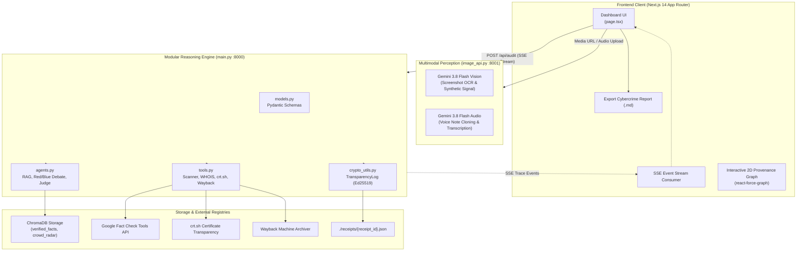
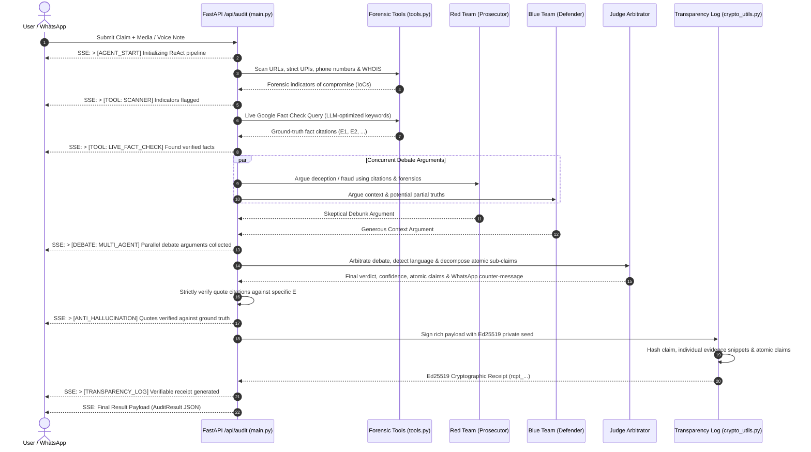
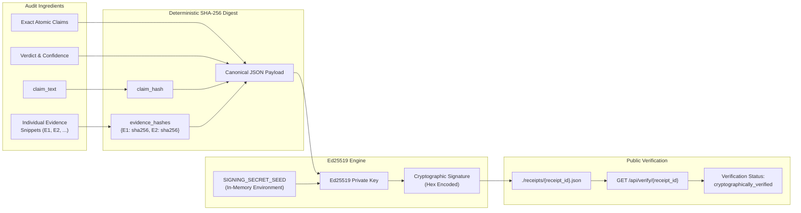

# 🛡️ DigitalScam: Real-Time Fact-Verification & Deepfake Audit Engine

[](https://forgebuildathon.com)
[](https://nextjs.org)
[](https://fastapi.tiangolo.com)
[](https://pynacl.readthedocs.io)
[](https://www.trychroma.com)
[](LICENSE)

> **Autonomous Multi-Agent Fact-Verification Tribunal with Cryptographic Ed25519 Verdict Receipts, Multimodal Audio/Vision Heuristic Signals, and Indian Cybercrime Pre-Fill Dossiers.**

---

## 🌟 Key Highlights & Rubric Alignment

1. **Autonomous ReAct Multi-Agent Tribunal**:
   - **Parallel Debate**: Agents execute concurrently via `asyncio.gather`. Agent A (*The Prosecutor*) debunks claims using ground-truth citations, while Agent B (*The Defender*) advocates context.
   - **The Judge Arbitrator**: Decomposes viral claims into atomic sub-claims, detects input language (English, Hindi, Hinglish), and authors WhatsApp-ready clarifications.
   - **Real-Time SSE Streaming**: Emits live tool execution steps to the frontend terminal via Server-Sent Events (`text/event-stream`).

2. **Verifiable Verdict Receipts (Ed25519 Transparency Log)**:
   - Eliminates blind trust in AI outputs. Signs rich canonical payloads (claim hash, individual evidence snippet hashes, atomic claims breakdown, and verdict).
   - In-memory seed management loaded via `SIGNING_SECRET_SEED` without insecure disk persistence.
   - Independent verification endpoint `GET /api/verify/{receipt_id}` for third-party cryptographic auditing.

3. **Immutable Wayback Machine Snapshots**:
   - Asynchronously triggers non-blocking snapshots (`https://web.archive.org/save/{url}`) with a strict 3-second timeout.
   - Parses response headers to persist actual timestamped snapshot links in every receipt (no wildcards).

4. **Verdict-to-Action Cybercrime Pre-Fill Dossier**:
   - Converts forensic detections into an actionable incident dossier formatted for Indian authorities: **cybercrime.gov.in**, the **1930 Financial Fraud Helpline**, and the **DoT Sanchar Saathi (Chakshu)** telecom portal.
   - One-click export downloads a structured markdown report with WHOIS registration ages, strict UPI handles, and Certificate Brand Lookalikes.

5. **Privacy-Preserving Crowd Radar**:
   - Tracks viral scam footprints across the network without ever storing raw claim text. Uses SHA-256 claim hashes as document IDs to prevent duplicate inflation.

6. **Strict Forensic Hardening**:
   - Strict Indian UPI regex (`@ybl`, `@paytm`, `@upi`, `@sbi`, `@icici`, `@okaxis`, `@axl`, `@ibl`) to eliminate false-positive email flagging.
   - Strict Indian phone number extraction (`+91` or 10-digit mobile).
   - Certificate Brand Lookalike scanner querying `crt.sh` with `%brand%` wildcards.

---

## 🏗️ System Architecture



---

## ⚖️ Multi-Agent Debate Tribunal Flow



---

## 🔏 Verifiable Verdict Receipt Flow



---

## 📁 Modular Codebase Structure

```text
DigitalScam/
├── main.py              # FastAPI app, lifespan, CORS, SSE audit endpoint, /api/verify
├── models.py            # Pydantic schemas (AtomicClaim, AuditResult, ReceiptPayload, etc.)
├── crypto_utils.py      # TransparencyLog class, strictly PyNaCl Ed25519 signing
├── tools.py             # Agentic tools (WHOIS, crt.sh lookalikes, Fact Check API, Wayback, Dossier)
├── agents.py            # Unified LLM query client, search keyword extractor, Red/Blue debate, Judge
├── image_api.py         # Multimodal service: Gemini 3.8 Flash Vision (OCR) & Audio (Voice Notes)
├── seed_db.py           # ChromaDB database hydration from Google Fact Check Tools API
├── requirements.txt     # Backend Python dependencies (FastAPI, PyNaCl, ChromaDB, Groq, etc.)
├── .env.example         # Clean environment configuration template (NO real keys)
├── .gitignore           # Enterprise security gitignore excluding all secrets & keys
├── receipts/            # Public JSON transparency receipts ({receipt_id}.json)
└── frontend/            # Next.js 14 App Router dashboard
    ├── src/
    │   └── app/
    │       ├── layout.tsx    # Root layout, PWA meta tags, manifest link
    │       └── page.tsx      # Interactive dashboard, SSE stream reader, Force Graph, Dossier export
    └── public/
        ├── manifest.json     # PWA Web Share Target manifest (WhatsApp / Twitter share target)
        └── icon.svg          # High-resolution vector security badge
```

---

## 🚀 Quickstart Guide

### 1. Prerequisites
- Python 3.10+ (Conda or venv recommended)
- Node.js 18+ & npm

### 2. Backend Installation

```bash
# Clone the repository
git clone https://github.com/your-username/DigitalScam.git
cd DigitalScam

# Install Python dependencies
pip install -r requirements.txt
pip install pynacl
```

### 3. Environment Configuration

Copy the example configuration:
```bash
cp .env.example .env
```

Edit `.env` with your API keys:
```env
GROQ_API_KEY="your_groq_api_key_here"
GROQ_MODEL=llama-3.1-8b-instant
GEMINI_API_KEY="your_gemini_api_key_here"
GEMINI_MODEL=gemini-3.8-flash
FACTCHECK_API_KEY="your_google_factcheck_api_key_here"
SIGNING_SECRET_SEED="<GENERATED_ED25519_SEED_HERE>"
PORT=8000
IMAGE_API_PORT=8001
```

*(Note: If `SIGNING_SECRET_SEED` is not provided, `TransparencyLog` generates a secure seed on startup and outputs instructions to add it to `.env`.)*

### 4. Hydrate Ground-Truth Database

```bash
python seed_db.py
```
*Fetches real verified claims from the Google Fact Check Tools API and embeds them into `./chroma_storage`.*

### 5. Launch Backend Services

**Terminal 1 (Core Reasoning & Transparency Engine):**
```bash
uvicorn main:app --reload --port 8000
```

**Terminal 2 (Multimodal Vision & Audio Engine):**
```bash
uvicorn image_api:app --reload --port 8001
```

### 6. Launch Frontend Dashboard

**Terminal 3 (Next.js Dashboard):**
```bash
cd frontend
npm install
npm run dev
```

Open [http://localhost:3000](http://localhost:3000) in your browser.

---

## 🔍 Independent Receipt Verification (CLI)

Every completed audit generates a verifiable receipt. Anyone can verify its cryptographic integrity via curl:

```bash
curl -s http://127.0.0.1:8000/api/verify/rcpt_your_receipt_id | jq
```

Expected response:
```json
{
  "receipt_id": "rcpt_7f3d82a1b9c4e0d5",
  "is_valid": true,
  "verification_status": "cryptographically_verified",
  "algorithm": "Ed25519",
  "public_key": "6a9b4c2e8f1d...",
  "signature": "3c8e71b2d04a...",
  "receipt": {
    "receipt_id": "rcpt_7f3d82a1b9c4e0d5",
    "payload": {
      "claim_hash": "e3b0c44298fc1c149afbf4c8996fb92427ae41e4649b934ca495991b7852b855",
      "evidence_hashes": {
        "E1": "8f434346648f6b96df89dda901c5176b10a6d83961dd3c1ac88b59b2dc327aa4"
      },
      "atomic_claims": [ ... ],
      "verdict": "False",
      "confidence_score": 95.0,
      "timestamp": "2026-10-31T18:05:00Z"
    },
    "archived_sources": [
      "https://web.archive.org/web/20261031180502/https://news.google.com"
    ]
  }
}
```

---

## 🛡️ License

This project is licensed under the MIT License. See [LICENSE](LICENSE) for details.

